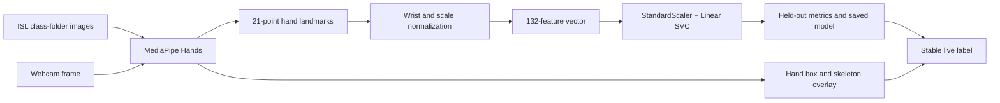

# Phase 1: Static ISL Sign Recognition

A free, local-first Phase 1 prototype for **static Indian Sign Language (ISL)
hand signs**. It extracts MediaPipe hand landmarks, normalizes them relative to
the wrist and hand size, trains a scaled Linear SVC, reports held-out metrics,
and can run live webcam inference with a hand skeleton and bounding box.

This is a static-sign research prototype, not a full ISL translator. It cannot
recognize movement-based signs, continuous conversation, facial grammar, or
sentence meaning. The dataset's labels and reuse terms must be checked before
training. A dataset downloader is included; the dataset and trained model are
kept out of this public source repository. The sample-run metrics and confusion
matrix are included as baseline evidence.

## Project layout

- `train.py`, `inference.py` — train the classifier and run the webcam demo
- `src/isl_recognition/` — landmark features, MediaPipe detection, and dataset loading
- `scripts/` — public dataset downloader and still-image prediction helper
- `tests/` — checks for feature extraction, data loading, and the classifier
- `docs/` — dataset attribution and the Phase 1 review sheet
- `artifacts/` — sample-run metrics and confusion matrix

The downloaded dataset, trained `.joblib` model, and image preview are local
files. Download the dataset and train the model before starting webcam
inference. See [dataset notes](docs/DATASET.md) for attribution and reuse terms.

## Phase 1 architecture



## Recommended Phase 1 dataset

The best match found for this static-sign milestone is Kaggle's [Indian Sign
Language (ISL) character-level dataset by Prathum Arikeri](https://www.kaggle.com/datasets/prathumarikeri/indian-sign-language-isl).
Kaggle lists it at about **294 MB**, with a **CC BY-SA 4.0** license. The
download has folders for digits 1-9 and letters A-Z; the creator notes that 0
is not included. Its still images fit the MediaPipe-landmarks + SVC Phase 1
pipeline.

There is one material caveat: the Kaggle description says the dataset combines
the creator's own images with images from other Kaggle and GitHub datasets.
Before presenting it as your final dataset, review the dataset page,
acknowledgements, license, and upstream credits. Attribute the creator and
preserve any required ShareAlike terms when distributing adaptations. The
license and provenance are not a substitute for checking that the signs and
class labels are accurate ISL; ask an ISL-knowledgeable reviewer to validate a
sample from every class. If class provenance cannot be established, present
your result as an experimental baseline rather than validated ISL recognition.

The research **INCLUDE** dataset and larger video corpora such as **ISL-CSLTR**
are better leads for later word/sequence phases, but they are not needed for
the static-sign prototype. Do not use ASL data as an ISL substitute.

### Download the recommended dataset

Use the Kaggle download button on the page above, extract the archive into
`data/isl_alphabet/`, and start training. Or use the included public downloader:

```powershell
python scripts/download_isl_dataset.py
```

The downloader keeps the archive under `data/raw/` and extracts images to
`data/isl_alphabet/`. Review and retain the source page and license with your
report. The extracted data and archive are excluded from version control.
See [dataset notes](docs/DATASET.md) for the source citation and folder layout.

## Requirements

- Windows, macOS, or Linux computer with Python **3.11, 64-bit** recommended
- Webcam for live inference (optional for training)
- Free Python packages listed in `requirements.txt`
- A class-folder ISL image dataset; download it with the included script or from Kaggle

No paid API, paid model, GPU, or cloud account is required. Training and
inference run locally. Google Colab's free tier is an optional fallback, but it
is not required and its availability/resources can vary.

## Install on Windows PowerShell

Open PowerShell in this project folder, then run:

```powershell
py -3.11 -m venv .venv
.\.venv\Scripts\Activate.ps1
python -m pip install --upgrade pip
python -m pip install --index-url https://pypi.org/simple --no-cache-dir --only-binary=:all: --no-deps -r requirements.txt
```

If PowerShell blocks activation, use the environment's interpreter directly:

```powershell
.\.venv\Scripts\python.exe -m pip install --index-url https://pypi.org/simple --no-cache-dir --only-binary=:all: --no-deps -r requirements.txt
```

The dependency list installs MediaPipe's hand-tracking runtime without its
optional JAX/audio extras, which this project does not use.

## Prepare the dataset

Put the extracted dataset outside Git tracking, for example:

```text
data/isl_alphabet/
  Indian/
    A/
      001.jpg
    B/
      001.jpg
```

The loader also supports `train/<label>/*.jpg` and `test/<label>/*.jpg` layouts.
The label is taken from the class folder name. Use only ISL classes. If the
dataset contains several frames from the same signer/session, keep those groups
together for evaluation by creating a CSV as described below.

## Train the model

Quick pipeline check on at most 100 images per class:

```powershell
python train.py --data data/isl_alphabet --max-per-class 100
```

The default MediaPipe hand-detection threshold is `0.3`, chosen to recover more
of the small/low-contrast dataset hands than `0.5`. The selected threshold is
saved in the model and reused by webcam inference. If it causes false hand
detections, compare a stricter run with `--min-detection-confidence 0.5` and
report the tradeoff.

Train on all images:

```powershell
python train.py --data data/isl_alphabet
```

The script writes:

- `artifacts/isl_static_svc.joblib` — local model bundle
- `artifacts/metrics.json` — data counts, evaluation metrics, per-class report,
  confusion matrix values, and limitations
- `artifacts/confusion_matrix.png` — visual error analysis

The repository includes the quick-run `metrics.json` and confusion matrix as
examples. Training creates or replaces these files and saves your model locally.

The metrics also include the percentage of images per label for which MediaPipe
found a hand. A missing-hand image is skipped rather than given a guessed sign.
The reported accuracy is for the recorded split only. Without signer IDs, the
default image-level split may include the same people or recording conditions
in training and evaluation, so do not present it as unseen-signer performance.

Metrics are computed on a held-out split. The default is a stratified
image-level split. If images are grouped by signer or recording session, use a
group-held-out split to avoid overly optimistic results. Create a UTF-8 CSV
with exact dataset-relative paths and one signer/session ID per image:

```csv
path,group
A/person01_001.jpg,person01
B/person01_001.jpg,person01
```

Then run:

```powershell
python train.py --data data/isl_alphabet --groups-csv data/groups.csv
```

The group split must leave every class in both training and evaluation data.
If it does not, the program stops with a message instead of silently reporting
misleading metrics. When a dataset has no signer/session IDs, report that
limitation clearly.

## Run webcam inference

After a successful training run:

```powershell
python inference.py
```

Options:

```powershell
python inference.py --camera 1
python inference.py --smooth-frames 9 --min-votes 5
python inference.py --show-margin
python inference.py --flip-input
python inference.py --min-detection-confidence 0.5
```

Press **Q** or **Esc** to close the window. The SVC margin is only a decision
score, not a calibrated probability. `--flip-input` should be used only if the
dataset's images are mirrored in the opposite orientation from the webcam.
Webcam access is local; frames are not uploaded or saved by this program.

## Preview one saved image without opening the camera

Once a model is trained, check an image offline:

```powershell
python scripts/predict_image.py --image data/isl_alphabet/Indian/A/1199.jpg
```

This prints the predicted class and saves a skeleton/box preview under
`artifacts/preview.png`. The folder name is not provided to the model.

## How the features work

Each detected hand contributes 21 wrist-relative XYZ landmarks normalized by
hand size. The fixed-length vector supports up to two hands, includes presence
bits, and retains the relative wrist displacement for two-hand signs. This
reduces translation and size variation but does not remove viewpoint, rotation,
lighting, camera-distance, or signer differences. The model therefore needs
held-out evaluation and real webcam checks.

## Phase 1 acceptance checklist

- [ ] Dataset is ISL-specific and its terms allow the intended use.
- [ ] Every output label is verified against an ISL source or knowledgeable
      signer.
- [ ] Training finishes and model, metrics, and confusion matrix are saved.
- [ ] Results include per-class errors; signer-held-out results are used when
      group metadata exists.
- [ ] Webcam shows a hand box, skeleton, and stable predicted label, or the
      webcam limitation is demonstrated and recorded.
- [ ] Presentation states that this recognizes static isolated signs only.

## Responsible use

Do not present dataset accuracy as proof of reliable communication. Ask an ISL
user or qualified language expert to check the label meanings and demo behavior.
If collecting additional webcam examples, obtain informed consent and avoid
storing identifiable recordings unless participants explicitly agree.
